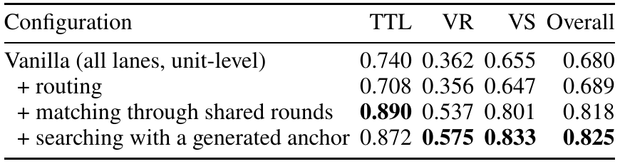
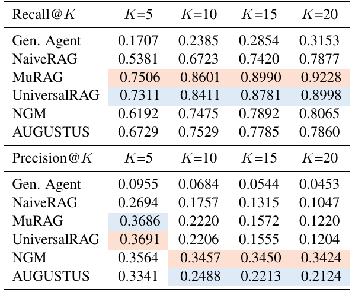

# MindBridge 在 ATM-Bench 与 Mem-Gallery 上的竞争策略

研究日期：2026-10-26。本文对应用户所说的 Mem-Gellery，即 Mem-Gallery。
代码依据是当前工作树，基底提交为
`42092a5fad5624955845d567380b555c3ef94642`，分支为 `mindbridge-v03`；
工作树有大量既有修改，不能把本文观察等同于该提交的干净版本。
[证据清单](artifacts/atm-gallery-sota-20261026/evidence-manifest.json)记录关键文件和论文提取原文校验值。

并行工作补记：审阅后段，工作区的 Retrieval 又出现量化候选扩窗与 SQLite FP32 重评分改动。
本文未修改这些代码；清单保留初读摘要并另记交付前观察摘要。
这类索引排序改动需要单独重测两榜，不能把本文引用的旧结果当作它的质量验证。

## 结论与优先级

MindBridge 最有希望的路线是：**保留原始证据，以可核验的检索与证据交付为主线，
按问题补齐状态变化和跨模态联系，再让经过任务验证的 reader 作答。**
当前最值得投入的是评测对齐、检索路由与实际媒体交付、充分证据条件下的阅读损失。
大规模重写记忆结构或统一开启所有规划、扩展、思考机制，缺乏本项目的实验证据。

两榜应采用不同重点：

- **ATM-Bench：**在官方 SGM 条件下优先研究精确词项与语义检索的互补、集合证据覆盖、
  事件窗口和来源有效性；raw 条件下增加按需视觉核验。Hard 单独研究有限的多步取证。
- **Mem-Gallery：**先核验查询原图、单图检索键、整轮图文和官方 Image ID 是否贯通；
  再处理视觉推断、知识更新、冲突和拒答。F1 与 judge 必须同时改善或明确报告取舍。
- **共同要求：**先和同模型、同输入、同预算的强原始证据 RAG 对比。
  当前代码已有同轮图文绑定、多检索键、规划、结构扩展和 context compilation，
  不能把这些能力重新命名后当作新贡献。

这些是有依据的研究优先级，尚不是已实现 SOTA 的结论。本轮没有运行真实模型评测。

## 目标必须按协议定义

### ATM-Bench 的公开竞争线

官方榜单的动态表格来自 HTML 和独立的 Hard 数据文件。
本轮读取的 main 表最近相关提交为
`3c67edbe85586ec9df161215133a3244d549d248`，提交时间为 2026-10-23 UTC。
页面展示的 “Last updated: 2026-10-04” 不能替代源码版本。
以下都是公开提交结果，尚未在本项目独立复现。

| 条件 | 系统及回答模型 | QS | Recall@10 | 怎样使用 |
| --- | --- | ---: | ---: | --- |
| Main | Graphon V1 + GPT-6 Astra | 81.71% | 89.78% | 本轮读取的非 Oracle QS 最高行 |
| Main | Graphon V1 + DeepSeek V4.1 Flash | 79.18% | 89.97% | 不同 reader 的系统行 |
| Main | Memexa v2 + DeepSeek V4.1 | 76.68% | 92.32% | 本轮 main 表中更高的召回参照 |
| Main | RE-call + DeepSeek V4 Pro | 68.43% | 90.10% | 检索及重排参照 |
| Main | MemPalace + Qwen3-VL-8B | 56.80% | 76.40% | 较接近原论文 reader 的公开参照 |
| Hard，31 题 | Memexa v2 + DeepSeek V4.1 | 63.57% | 63.05% | Hard 的独立竞争线 |

依据：[官方榜单](https://atmbench.github.io/leaderboard.html)、
[main 表固定版本](https://github.com/atmbench/atmbench.github.io/blob/3c67edbe85586ec9df161215133a3244d549d248/leaderboard.html)、
[Hard 数据](https://github.com/atmbench/atmbench.github.io/blob/main/static/js/atm_hard_rows.js)。

81.71% 和 92.32% 来自不同系统，不能拼成一个现有系统的成绩。
Graphon 自行处理原始媒体，同时保留官方 processed-memory 字段；Memexa v2 使用自制描述和
source-grounded cards；RE-call 使用另一套 embedding/reranker。以上不构成相同输入和算力条件。
Graphon 可作为成绩参照，本轮没有获得可复现的完整开源实现。

另一个版本陷阱是：Memexa 的冻结 release 写 main QS 78.26%，且说明使用 DeepSeek judge；
官方榜后来列出 gpt-5-mini 重评后的 76.68%。对榜应使用榜单对应版本，不能混用 release 分数。
其公开仓库明确只是开源 demo，完整桌面产品并非全部开源；冻结档案也说明不能直接重跑新模型实验。
[冻结 release](https://github.com/labazhou2024/memexa/releases/tag/atmbench-memexa-v2-20261002)、
[公开源码边界](https://github.com/labazhou2024/memexa/blob/main/README.md)。

### Mem-Gallery 没有一个可以混用的 SOTA 数字

| 文献及条件 | 结果 | 必须保留的限定 |
| --- | --- | --- |
| 原论文 v1，Qwen2.5-VL-7B，MuRAG | F1 0.6966 | 原论文 Table 3 的同 backbone 参照 |
| Omni-SimpleMem v2，GPT-5.1 | F1 0.810 | 作者 Table 1；不能只追超过 0.6966 |
| V-Mem v1，Qwen2.5-VL-32B | judge 0.829 | gpt-4o-mini judge；其 F1 为另一指标 |
| MHG-Mem v1，Qwen3.8-27B | F1 0.6607，judge 0.8785 | GPT-5.4-mini judge，作者报告三次运行平均 |

依据：[Mem-Gallery，p.7](https://www.alphaxiv.org/pdf/2601.03515?page=7)、
[Omni-SimpleMem v2，Table 1](https://arxiv.org/html/2604.01007v2)、
[V-Mem，p.6](https://www.alphaxiv.org/pdf/2608.01543?page=6)、
[MHG-Mem，Table 1](https://arxiv.org/html/2610.29995v1)。

这些是**不同实验中的强结果**，不能按数字大小排成统一榜单。
尤其 V-Mem 对 Omni 的重跑分数与 Omni 自己论文里的分数差别很大。
应取得相同题目预测，在相同 scorer 下重评，再比较系统，而非仅比较论文表格。

Mem-Gallery 正式评测应覆盖全部 20 个 topic、1,711 题和九类能力。
其中 184 题是 answer refusal；排除它们会改变总体含义。
图像查询、视觉搜索的 ID 输出，以及冲突检测的格式都必须保留。
原论文采用 Qwen2.5-72B-Instruct judge，近期论文采用了不同 judge。
上游代码还会把五级提示得到的分数映射到 0、0.5、1；只复用提示词不保证计分一致。
[官方实现，固定版本](https://github.com/YuanchenBei/Mem-Gallery/blob/a93959e1e978a6a7d77798ae92c2ffe41c538c62/benchmark/memengine/evaluate/evaluation.py)。

## 最有解释力的原始证据

V-Mem 的消融把三类改动分开。最明显的提升来自把检索命中的单元恢复成关联的完整 round；
整体分数从 0.689 到 0.818。路由和生成检索锚点的整体收益较小，
论文附录的区间均包含零。不能把全部提升归因于更复杂的 query rewriting。

出处：[V-Mem，p.6](https://www.alphaxiv.org/pdf/2608.01543?page=6)。
作者对其局限的原文是：“A backbone that cannot use that content gains nothing from it.”
7B 条件下 V-Mem 的 judge 0.509，反而低于 Omni 的 0.534。
[V-Mem，p.13](https://www.alphaxiv.org/pdf/2608.01543?page=13)。

第二个关键证据来自原始 Mem-Gallery：增加 K 提高召回，同时降低 precision。
作者明确指出：“the expanded retrieval coverage does not consistently translate into better QA performance.”

出处：[Mem-Gallery，p.8](https://www.alphaxiv.org/pdf/2601.03515?page=8)。
这两张表说明应研究“必要证据是否送达并被正确使用”，而不只是增加候选数。

## MindBridge 自身的证据与实现

### 已经做对的部分

1. **保留原始记录和媒体。** SQLite 是权威存储，Zvec 可重建，派生记忆有来源。
   这与最新原始历史 RAG、JAM 及 MHG-Mem 强调的可回看证据方向一致。
2. **同轮图文已经绑定。**
   [Gallery adapter](../../src/mindbridge/benchmarks/eval_adapters.py#L1200)
   将 user、assistant、原图与 Image ID 存为一条记录，问题原图也保留。
   因而 V-Mem 的 shared-round 主收益不能直接算作 MindBridge 的新增空间。
3. **已有多检索键和 hybrid。**
   [Embedding](../../src/mindbridge/kernel/embedding.py#L272)生成 aggregate、文本块和原子媒体键；
   [Retrieval](../../src/mindbridge/kernel/retrieval.py#L243)已结合 query 多键和 lexical 路径。
   增加 chunking 或 BM25 本身不是新策略。
4. **已有时间、范围、结构检索。**
   [Answering](../../src/mindbridge/kernel/answering.py#L138)支持实体、窗口、邻居与关系读取；
   [Compilation](../../src/mindbridge/kernel/compilation.py#L277)有来源闭包和竞争 lineage。
   应复用这些 plane，保持 Memory facade 只验证、连接和转发。

### 历史实验真正支持什么

| 本项目记录 | 观察 | 对本轮的含义 |
| --- | --- | --- |
| ATM main-SGM 全 1,013 题，hybrid score completion | task score 0.43792→0.62505；实际 reader 12-source recall 0.49348→0.75772；完整 gold 覆盖 547→791 | 优先修正确的评分与候选覆盖，效果可能远大于新建抽象 |
| ATM main 历史损失分解 | 79.2% 题的 window 已包含全部 gold；该组分数仍仅 0.681，拒答 14.1% | 检索之后的媒体理解与证据使用是主攻方向之一 |
| ATM Hard 31 题，规划消融 | best-effort 0.2007→加 planning 0.2701；main 上未稳定受益 | 规划应该窄触发，Hard 小样本不能推出全局结论 |
| Gallery 224 题的扩窗诊断 | judge 0.6004→0.6674；F1 0.1708→0.1395 | 正确性、答案长度和输出约束必须拆开 |

出处：[hybrid 全量记录](hybrid-score-completion-2026-09-08.md#atm-complete-main-sgm-characterization)、
[baseline 损失分解](2026-09-12-baseline-loss-decomposition.md)、
[规划记录](2026-09-10-recall-programs-round.md#measured-outcomes)、
[扩窗记录](../configuration.md#local-memory-settings)。
这些多使用 Qwen reader 和 proxy judge，而且问题已暴露；原始运行结果在此 checkout 未找到。
它们支持机制判断，不能作为当前版本的官方榜单分数。

224 题 Gallery 诊断还有额外限制：
[corpora.py](../../benchmarks/corpora.py#L89)只保留 clue 非空的题，
并省略问题图、point 和部分官方格式信息；
[support_coverage.py](../../benchmarks/support_coverage.py#L746)又按证据缺口抽样。
正式评测应复用完整的
[eval_adapters.py](../../src/mindbridge/benchmarks/eval_adapters.py#L1178)，
不能把机制诊断的平均分当成全 1,711 题结果。

### 现在最容易误判的缺口

- **规划不等于新的语义检索。**
  [similar](../../src/mindbridge/kernel/answering.py#L148)明确忽略传入 query，
  返回原问题排名的前 k 项。当前多轮可以做结构读取，但不是任意子问题重新检索。
- **图像存在不等于图像路线有效。**
  查询图不会自动经过写路径的 caption；
  [Vision](../../src/mindbridge/kernel/vision.py#L138)明确将 pending description 限于写入。
  应核对真实 embedding 与 provider 输入，不能以“配置过 vision”代替检查。
- **ask 与 compile 不共享全部证据交付保证。**
  默认评测走 ask；compile 的闭包、片段和冲突信息并不会自动进入 ask。
- **24,000 字符不是严格的最终模型输入上限。**
  [budgeted hits](../../src/mindbridge/kernel/answering.py#L540)先保留初始 limit，再补充；
  媒体和 provenance 还会带来额外成本。等预算实验必须看实际 token、图像和调用数。
- **原始视频保存了，但可检索描述可能没覆盖关键帧。**
  [视频描述采样](../../src/mindbridge/models/openai_sdk.py#L3764)固定约四帧；
  这可能影响瞬时动作或 OCR 的可检索性，不等于视频原件被删除。

## 从论文和开源实现借鉴什么

### V-Mem 优先用于校准路线与整轮证据

复用其“匹配什么模态、返回什么证据”的区分，检查图像查文字、文字找图、
图像找图以及普通文本题是否被同一融合公式稀释。
先对现有单图键和 aggregate 键做消融，而非先引入一个新向量库或新记忆图。
同轮绑定已经存在，真正的新实验是**路由、融合和实际交付是否使用了这种绑定**。

检索锚点只作为次级候选：生成内容只用于寻找原件，不可成为记忆事实。
计数和枚举题不能用一个想象中的场景替代需要穷举的目标。
代码核验版本为 `36916b14dc5241e04acbf5cd0f3c40799bc09550`。
[retrieve.py](https://github.com/Dingyi-Kang/V-Mem/blob/36916b14dc5241e04acbf5cd0f3c40799bc09550/retrieve.py)、
[memory.py](https://github.com/Dingyi-Kang/V-Mem/blob/36916b14dc5241e04acbf5cd0f3c40799bc09550/memory.py)。

### Omni-SimpleMem 优先用于原始文本与输出协议

论文报告原始 dialogue 替代摘要、约束位置与精确引用对 F1 很重要，
其公开结果比原论文 MuRAG 更有竞争力。但 MindBridge 的 Gallery adapter 本来保留原始 round，
所以应对比**原文有没有实际进入 reader，以及同一预测如何计分**。
论文附录还误释了一些任务缩写，应以原始 benchmark 定义为准。

本项目历史上“更短、更精确”提示曾显著增加拒答；不能照抄一句短答案指令。
可研究“先在内存中得到带证据的答案，再用不读取 gold 的格式化步骤输出”，
与单次直接回答配对；必须包含等调用成本的对照，并保留 AR/CD/VS 官方约束。
[论文 v2](https://arxiv.org/html/2604.01007v2)、
[实际开源目录](https://github.com/aiming-lab/SimpleMem/tree/main/OmniSimpleMem)。

### MHG-Mem 优先用于状态变化和回看原件

值得迁移的是 entity mention、aspect-specific state 和 source evidence 的联系，
而非“使用超图”这个名称。其 Gallery 消融中，去掉 agentic search 后 judge
87.85→82.06，去掉 source inspection 后为 84.64；这些是作者协议内的结果。
更窄的 MindBridge 实验是固定初始 anchor，补齐该状态的必要原件和纠正记录，
观察 KR/CD/TR 和视觉核验题，而非全面重建超图。

状态不能简单按 recorded_at 取最新；历史叙述、最终账单、计划、取消和真实发生时间
需要区分。优先复用 formation、lineage、validity 和 compilation。
本轮读到论文方法、消融及附录，未确认可运行的官方代码仓库。
[MHG-Mem](https://arxiv.org/html/2610.29995v1)。

### PACE-Mem 用于检验互补选择

它把 MMR 证据组成与返回长度一起选择，不增加 foundation-model 调用；
论文在长视频任务中报告相近深度下优于 Adaptive-k。**尚无 ATM/Gallery 直接证据。**
因此可迁移选择器，不能迁移预期增益。

MindBridge 应按原始 source/round 计覆盖，避免同源多个 embedding 或摘要占满预算；
但近似视觉内容可能就是区分“哪一次”的关键证据，不能被相似度去重误删。
先比较 fixed top-k、单纯加深排名、固定预算 MMR，再单独加入动态长度。
代码核验版本为 `8a33ab65d8bf71f5a348d2da06ba66d807ae67fd`。
[论文](https://arxiv.org/html/2610.24378v1)、
[开源选择器](https://github.com/Shidu-Ren/PACE-Mem/tree/8a33ab65d8bf71f5a348d2da06ba66d807ae67fd/pace_mem)。

### JAM 用于有限的运行时取证

JAM 保留完整历史，由 Researcher 在问题出现后搜索、读取、检查是否足够；
其 SFT 和 RL 是明确的训练路线。本轮没有发现它在这两榜直接验证的结果。
MindBridge 可以先验证不训练的有限动作集：现有 search、实体/时间读取、source inspect，
并采用结构化证据链。通用 shell 和自主工具 agent 应放在 host/benchmark arm，
不应让嵌入式 memory kernel 变成通用 agent framework。

只有有限多步检索在未用于开发的样本上稳定优于强 RAG，才有理由投入策略训练。
训练集使用独立合成或授权语料；ATM 的 31 个 Hard 问题不能充当训练/调参集。
[JAM](https://arxiv.org/html/2609.34385v1)、
[关联项目](https://github.com/VectorSpaceLab/general-agentic-memory)。
关联仓库目前自称 GAM，不能仅因链接存在就当作完整训练复现包。

### 强原始证据 RAG 是必须击败的基线

两篇近期研究分别用 controlled retrieval 和 dense+rereank 说明：
复杂记忆在一些文本长期任务上不稳定优于原始历史 RAG；
构建时丢证据和检索时找不到证据是不同问题。
它们没有直接证明 ATM/Gallery 上的输赢，但足以要求 MindBridge 提供一个强基线。
[Controlled comparison](https://arxiv.org/html/2610.24671v1)、
[RAW-RAG](https://arxiv.org/html/2610.30755v1)、
[开源实现](https://github.com/Litmeb/RAW-RAG)。

RE-call 也适合对照精确词项、reranking、validity 和 abstention；
其 ATM 行用了 Voyage 检索与重排，不能把整个系统成绩归因于其中某个模块。
学习方法即可，无需引入 PostgreSQL 服务；其公开实现为 AGPL-3.0，
代码复用需要另行处理许可证兼容性。
[RE-call](https://github.com/GiulioDER/RE-call/blob/master/README.md)。

## 两榜的具体策略

### ATM-Bench 先攻三类错误

**第一类是“找到了近似事件，却没找齐正确证据”。**
针对昵称、地点、收据号码、邮件中的实体，保留 lexical 与 dense 的互补；
在候选集合固定后单独试 cross-encoder reranking。
对 list/number 问题，使用有边界的实体或事件集合读取，显式检查穷举范围。
正式 Recall@10 按十个不同原始 memory item 计，不能用一百个内部候选替代。

**第二类是“第一跳定位事件，第二跳需要另一模态”。**
例如邮件定位餐厅与时间，再读关联照片，而不是直接搜索相同菜名。
先使用已有 window/entity/related；若失败确实来自第二跳无法产生新语义候选，
再测试一个 scoped 子查询，与相同数量的原问题排名增宽比较。
这能区分“新查询有用”和“只是多看了”。

**第三类是“证据已在上下文，仍取错旧值、金额或日期”。**
在不改检索的条件下换 reader，或加入一次明确的 source inspection；
比较 raw 媒体与 SGM 的 gold-only 条件，分清感知、表示和推理损失。
金额和日期运算先提取带来源的操作数，再做确定性计算；
不得让模型从内容中生成任意代码在 kernel 执行。

建议保留两个正式结果：官方 SGM 可比路线，以及单列的 raw+自制表征路线。
Hard 的工具 agent arm 单独报告，不能把外部 coding agent 的完整能力算作 Memory.ask。

### Mem-Gallery 先打通视觉链路，再优化知识管理

**第一步检查 TTL、VR、VS。**
对有问题原图的样本，验证 query image 进入正确的 embed request；
对候选 round，验证回答请求中有它的原图、文字和官方 Image ID。
先测单图 query key 与混合 key 的选择/融合，再判断是否需要额外视觉编码器。
如果引入独立 SigLIP 空间，必须显式设计持久化 identity、投影与重建；
不能把不兼容向量混进现有 durable embedding space。

**第二步研究 KR、CD、TR。**
保存同一实体不同方面的变化，返回当前结论需要的历史对照与纠正来源。
先对固定 anchors 做必要闭包，不能把整个 persona 的 history 交给 reader。
derived assertion 与原始证据必须区分；增加一条摘要不是增加一份独立证据。

**第三步做输出及拒答校准。**
比较同样证据下的短答案、Image ID 输出、冲突二值答案和不充分证据行为。
用真实不足、可回答但相似、同实体旧值冲突三种样本检验；
拒答不能只看 cosine 或让模型自报 confidence。
保留 judge 正确性和 F1 双指标，避免把少说几个词造成的 F1 上涨当成记忆进步。

## 最小实验序列

以下是待执行的实验方案，阈值和预算应在看新结果之前冻结。
无需一开始把所有候选叠加。

| 阶段 | 实验及对照 | 主要判定 | 停止条件 |
| --- | --- | --- | --- |
| E0 | 冻结模型快照、数据、scorer、完整媒体路径；导出官方格式预测并重评分 | 分母、ID、输入、计分可重现 | 官方计分或媒体路径未对齐 |
| E1 | gold-only 原件、gold-only SGM/caption、正常候选、实际提交上下文 | 分解表示、检索、packing、感知和阅读损失 | 诊断仍只记录候选而非实际 reader 输入 |
| E2 | 当前 MindBridge vs 同模型强 raw-evidence RAG；Gallery 加 V-Mem/Omni 可复现 arm | 全量 F1/QS、judge、来源召回、成本 | 只击败 blind/random，未击败强基线 |
| E3 | Gallery 单图/混合 query key、模态路线、传输对照 | TTL/VR/VS，实际图像数与来源覆盖 | 收益仅来自额外图片或已存在的 round 绑定 |
| E4 | 固定 anchors，加必要来源/纠正闭包 vs 等量 ranked tail | KR/CD/TR、完整支持和回答 | 新增闭包挤掉更有用证据 |
| E5 | ATM 现有结构计划 vs 单次 scoped 子查询 vs 等量增宽 | list/number/Hard 多证据题 | 只增加调用和 token，无稳定质量收益 |
| E6 | 固定预算重排、互补选择；另做动态预算曲线 | QS/F1 与真实 token、媒体成本的前沿 | 相似事件被错误去重，或只有 recall 提高 |
| E7 | 固定实际证据，reader 与输出协议配对 | 充分证据条件下正确率、AR/CD、F1 | 过度拒答、猜测或仅格式分提升 |
| E8 | 只组合通过前序的机制，完整官方重评 | 对同协议强基线的最终差异 | 开发集收益不能复现 |

E1 的 gold 输入仅用于离线诊断；正常运行的检索器、planner、formatter 不能看到 gold、
clue IDs、参考答案或标注的难度类别。
官方规定的格式约束可以沿用，但不能把 evaluator 的 point 当作额外检索特征。
没有 gold 的 AR 题单列做缺失/扰动对照，不应伪造 gold-only 上界。
gold round 到达也不意味着关键像素已被模型看清。

建议先按 persona 留出 Gallery 测试 topic，开发中按九类抽取诊断集；
图像题、冲突和拒答都必须出现。ATM main 已有历史全量暴露，
新的“holdout”只能准确称作新的操作性切分，不能称未见测试集；
Hard31 不适合作为反复搜索配置的主开发集。

统计上 Gallery 按 persona 做 cluster bootstrap，并保留每类结果；
ATM 是一份个人语料，题级区间只能描述这份固定语料，不能推到用户总体。
最终运行记录每个计划题目，错误记零并报告失败数，不能只平均成功响应。

## 接入边界与成功标准

实现应沿现有分工：

- Retrieval plane 负责候选、路由和排序；Answering plane 负责有限取证编排。
- Compilation plane 负责预算、经过验证的 excerpts、来源闭包和冲突交付；
  抽取共同纯逻辑优于复制一套 ask/compile 规则。
- Formation/Control 负责受验证的状态更新和可撤销派生；Vision 负责可检索视觉证据。
- 模型适配器只处理明确的能力和传输；benchmark 模块保持叶子，行为评测调用公共 SDK。
- 每个 persona、run 和对照的 store 物理隔离；不以 metadata 隐式 scope 替代。
  SQLite 先提交、Zvec 派生 outbox 的规则保持不变。

正式声明 SOTA 时，应提供完整预测、模型与数据 revision、代码及配置摘要、
官方 scorer/judge、实际输入路线、top-10 来源、运行失败、三次推理重复及成本。
同模型同预算的胜出说明 memory 机制进步；使用更强模型获得榜首应明确称整套系统结果。
ATM 的 main QS 超过本轮 81.71% 行、Hard 超过 63.57% 行，是公开成绩目标；
召回最高行需要单独对照。Mem-Gallery 应复现 Omni 的强 F1 与 V-Mem/MHG 的
正确性参照后再谈领先，不能把不同 judge 的 0.8785 当成统一门槛。

现阶段的优先顺序是 **E0/E1 → 强基线 → Gallery 视觉链路与 ATM reader →
窄定向补证 → 互补选择 → 选择性组合**。
若只能先做一件事，做逐题的“实际证据交付与错误分解”，因为它会决定随后应改哪一层。

## 检索范围与证据边界

本轮通过 alphaXiv 的关键词与语义检索完成两轮主题发现，通读以下九篇论文的相关方法、
实验和限制，并读取关键附录：ATM-Bench、Mem-Gallery、V-Mem、PACE-Mem、JAM、
Omni-SimpleMem、MHG-Mem、Controlled Comparison、RAW-RAG。
优先顺序依据与两榜的直接相关性、消融可信度和 MindBridge 的可迁移缺口。
其他发现如 Mem++、PMMC、CABLE 等未在本文形成方法级结论。

开源调查覆盖官方 benchmark/scorer、V-Mem 检索代码、PACE 目录与公开说明、
SimpleMem/Omni 公开目录、RAW-RAG、controlled comparison、RE-call、Memexa 冻结资料
及 GAM 关联仓库。没有运行这些外部系统，也没有把 README 宣称当作独立复现实验。
本轮只新增研究文档与原论文表格裁图，未修改产品代码、提示词或检索策略，
未启动付费服务、训练或榜单提交。

本轮[检查记录](artifacts/atm-gallery-sota-20261026/validation.json)：lock、Ruff、Mypy、
2,578 项测试、diff、固定版本 Markdown 与链接检查均通过；两张裁图已目视核验。
产品代码在并行编辑，以上不是不可变产品补丁的最终认证，也不提供新的模型质量证据。
