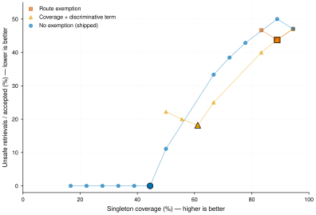

# Top1 歧义：来源豁免审查与风险—覆盖率对照

2026-10-27。结论：R03 的控制流问题成立，值得修复；已经复现歧义证据被单条交付，
没有把它表述为真实生成模型已经答错。修复删除 lexical route 对 top1 歧义检查的无条件豁免。
这恢复了门槛的一致性，没有把检索分数校准成正确概率。

## 根因与修复边界

`retrieval_is_ambiguous` 原先在 `first[3]` 为真时直接返回 `False`。这个布尔值来自
候选是否经过 lexical route，与完整覆盖、事实一致性、身份唯一性没有等价关系。
两条内容都包含 Alice、甚至完整覆盖查询词，但一条说营业、一条说停业，仍能走这条例外。
只要求完整覆盖也不够：否定、同名人、问题复述都可能满足词面匹配。

词法覆盖已进入 relevance 融合；来源本身再提供拒绝豁免，给了同一检索路径第二份特权。
因此采用最小的根因修复：删除来源豁免，保留原有分数、分差尺度、默认 `0.01`、相关性门槛、
时间过滤和排序。没有另加覆盖阈值、矛盾检测器或正确率预测器。

只有 `limit=1` 要求消除这类 top-two 歧义。`search` 默认 `limit=10`，`ask` 默认
`limit=5`，多结果继续保留替代证据。`ambiguity_margin=0` 仍显式关闭拒绝。
`lexical_match` 继续作为来源诊断字段存在。公开签名、响应结构、依赖、存储格式均未改变。

## 对照协议与可复现输入

[固定探针与 runner](../../src/mindbridge/benchmarks/top1_ambiguity.py) 的版本是
`top1-ambiguity-v1`。18 个手写案例包含同名人、否定、未结构化的陈旧偏好、有效时间过滤、
事件时间、部分匹配、明确匹配、可用的高分近邻、问题复述与存储文本中的注入指令。
11 个案例有独立指定的可接受记录，其余案例没有安全的唯一记录。
这些标签不传入检索器。

每个案例拥有独立临时 `data_dir`，通过公开 SDK 写入，再使用真实 SQLite、Zvec、
hydration、融合和过滤。唯一替代的模型边界是固定二维单位圆 embedding：
query 为 `(1, 0)`，文档为 `(cosine, sqrt(1-cosine²))`。
它刻意制造可辨识与近分情形，不模拟自然语言模型的语义能力。
模型标识为 `top1-ambiguity-v1`，空间为 `top1-ambiguity-v1:2:unit-circle`；
没有生成模型、judge 或提供商返回身份。运行时版本及 runner 的 SHA-256 保留在结果文件中。

三个策略共享每个案例的同一份多结果排序与资格门槛，仅回放 top1 接受决策：

- `route_exemption`：原始行为，第一名经过 lexical route 即豁免。
- `no_exemption`：删除豁免，使用现有分差规则。
- `coverage_exemption`：实验对照，第一名完整覆盖查询词，且至少有一个查询词不存在于
  **所有**分差内竞争者的词项并集中，才允许豁免。这里查询均为英文关键词，覆盖按精确词项
  集合计算；不是产品的 IDF 权重估计，也不是已验证的答案充分性检测。

无时间短语时回放 `gate_relevance` 分差；有显式时间短语的两个案例回放最终分数，
与原有函数一致。扫描包含零、默认门槛、固定网格、每个观测分差及其下一个浮点数；
三个策略使用相同门槛集合，没有只挑有利的门槛。零仍表示禁用，不是拒绝所有。

修复前的 [SDK 原始结果](artifacts/top1-ambiguity-20261027/baseline.json)
逐案例匹配 route 回放。修复后的
[完整结果与所有工作点](artifacts/top1-ambiguity-20261027/results.json)
逐案例匹配 no-exemption 回放；两次运行的多结果候选、分数与顺序逐项相同。
正反插入顺序测试另检查同名、有效时间与问题复述案例。

## 风险、保留与代价

这里的 coverage 是非空 top1 交付数除以全部 18 个查询；risk 是不安全或错误记录交付数
除以非空交付数。没有交付时 risk 为 `null`，不能记作零风险。
这是**检索代理指标**，不是自然语言回答覆盖率或回答错误率。
另外单独记录正确交付、有答案案例的保留率、有答案但拒绝的次数，以及第一名正确却被拒绝
的次数，防止靠扩大拒绝范围掩盖损失。



18 个确定性探针，每个策略扫描同样的 31 个门槛，单次固定输入；没有抽样置信区间。
大标记为默认 `0.01`，细线仅连接
实测工作点，不能插值得到未测风险。覆盖率越高越好，风险越低越好。

默认门槛下，原策略交付 16 条，其中 9 条正确、7 条不安全；删除豁免后交付 8 条，
全部正确；覆盖与区分词豁免交付 11 条，其中 9 条正确、2 条不安全。
第三种策略仍放行问题复述和注入文本，说明区分词不能证明内容在回答问题。

删除豁免保留了 9 个原来正确第一名中的 8 个；丢失的是 `useful-near-tie`。
正确交付占全部 11 个有答案案例的比例从 9/11 降到 8/11。
有答案但被拒绝共 3 个，其中两个原来第一名就是错误文本；另一个才是正确第一名的误拒绝。
有效时间与事件时间已消除竞争的案例继续交付。默认工作点没有新增不安全交付，
但不能将这个小型定向集上的 `0/8` 推广为部署零风险。

**曲线不支持全域优越或已完成统计校准。** 在双方都能达到的 16/18 覆盖率处，原策略
有 7 个不安全交付，删除豁免的策略有 8 个；后者在该工作点更差。
在 9/18 覆盖率处，删除豁免与覆盖豁免分别有 1、2 个不安全交付。
这既说明来源例外缺乏依据，也说明单靠调分差不能恢复所有正确近邻。
没有根据这些探针修改默认门槛，也没有把“更多拒绝”称为回答准确率提升。

## 近期证据如何影响决策

仓库前一天的 [FP32 检索评测](2026-10-26-accuracy-first-retrieval.md) 改善了量化候选发现
和评分精度，但明确只证明合成向量检索性质。准确的余弦仍不等于正确答案概率，
它不能为来源豁免提供依据。

近期 [PriceCheck 预印本](https://arxiv.org/html/2609.37493v1) 将验证器排序和被交付答案的
错误风险区分开，使用独立校准与相同覆盖率下的比较。这里采用其评估原则，
没有移植其数学任务上的风险保证。
[显式记忆与原始历史的受控比较](https://arxiv.org/html/2610.24671v1)
固定已构造记忆，并控制检索器与上下文预算来区分收益来源；本次固定输入和排序，只改变门槛。
二者都是近期研究证据，不是 MindBridge 的线上效果证明。

修复的通过条件是：来源不能跳过显式歧义门槛，默认 SDK 与回放一致，多结果排序不变，
真实存储回归测试通过，并公开正确候选损失。若要宣称业务风险校准，还需要固定真实
embedding/answerer 快照，在独立校准集选择门槛，再用未参与选择的真实任务测试集验证
回答覆盖、错误率与正确保留；本次没有运行这些服务检查。

## 复现与验证

```bash
uv run --frozen --no-sync python -m mindbridge.benchmarks.top1_ambiguity \
  --output docs/research/artifacts/top1-ambiguity-20261027/results.json
uv run --frozen --no-sync pytest -W error \
  tests/unit/test_top1_ambiguity.py tests/benchmarks/test_top1_policy_replay.py
mkdir -p .benchmarks/top1-ambiguity
orx skill figures/assets/orx_figstyle.py > .benchmarks/top1-ambiguity/orx_figstyle.py
uv run --no-project benchmarks/plot_top1_ambiguity.py \
  --results docs/research/artifacts/top1-ambiguity-20261027/results.json \
  --style .benchmarks/top1-ambiguity/orx_figstyle.py \
  --output docs/research/artifacts/top1-ambiguity-20261027/risk-coverage
```

绘图在独立脚本环境安装 Matplotlib，不增加产品依赖。
回归先在旧实现上观察到失败，再删除豁免；测试保留中英文、hybrid/lexical、
有效时间、显式关闭门槛与多结果保留，并核验风险分母和竞争者并集计算。
原有衰减、遥测和 recall-program 测试显式关闭歧义门槛，以继续只验证其各自行为。

本轮验证使用 Python 3.12.14、NumPy 2.3.5、Zvec 0.8.0：

- 相关文件测试一轮 360 项通过；补充 `ask(limit=1)` 断言后的聚焦检查 14 项通过。
  隔离进程恢复旧来源豁免后，6 个中英文回归全部按预期失败。
- lock 检查、全仓 Ruff lint、`git diff --check` 通过；全仓 Ruff 格式检查曾通过，
  最后检查时并行更新的 `tests/unit/benchmarks/test_eval_diagnostics.py` 又出现格式差异。
  本次修改文件的格式检查通过。本次三个新增
  SDK/回放测试与 benchmark 文件的严格 mypy 检查通过。
- 全套 `pytest -W error`：2,825 项通过、12 项真实服务测试因未启用凭据评测而跳过、
  3 项失败。共享工作区同时有其他改动；失败均在未被本次修改的
  `tests/unit/benchmarks/test_eval.py` 中：
  `test_response_cache_namespace_changes_with_runner_recipe`（schema 20 与预期 19 不同）、
  `test_a_fully_cached_unit_completes_its_ingest_share_without_writing`
  （缓存替身缺少 `generation_evidence`）、
  `test_runner_reports_cached_progress_before_pending_answer_finishes`（等待进度超时）。
- 最新全仓 mypy 未通过：其他并行新增测试中的 `_plan` 生成器参数类型
  （`tests/unit/test_memory_api.py`）、返回 tuple 长度类型
  （`tests/unit/test_runtime_capacity.py`）、answerer 协议签名
  （`tests/unit/test_rest_capacity.py`）共 3 处错误。本次不改写这些测试的实现。
- CONTRIBUTING 固定版本的 Markdown 检查曾通过；最后全仓扫描又发现其他并行新增的
  `.superpowers/boundary-cleanup/plan.md` 和 `progress.md` 有 Markdown 格式错误。
  同版本 Lychee 的最近一次全仓检查
  866 个链接通过、没有错误、一个超时，发生在其他研究页的 W3C SKOS 外链。
  没有为超时添加排除项。图形 audit 为 `clean`，并渲染检查过 PDF。

这些是各命令运行时的共享工作区结果，不能表述为全仓质量门槛全部通过。
